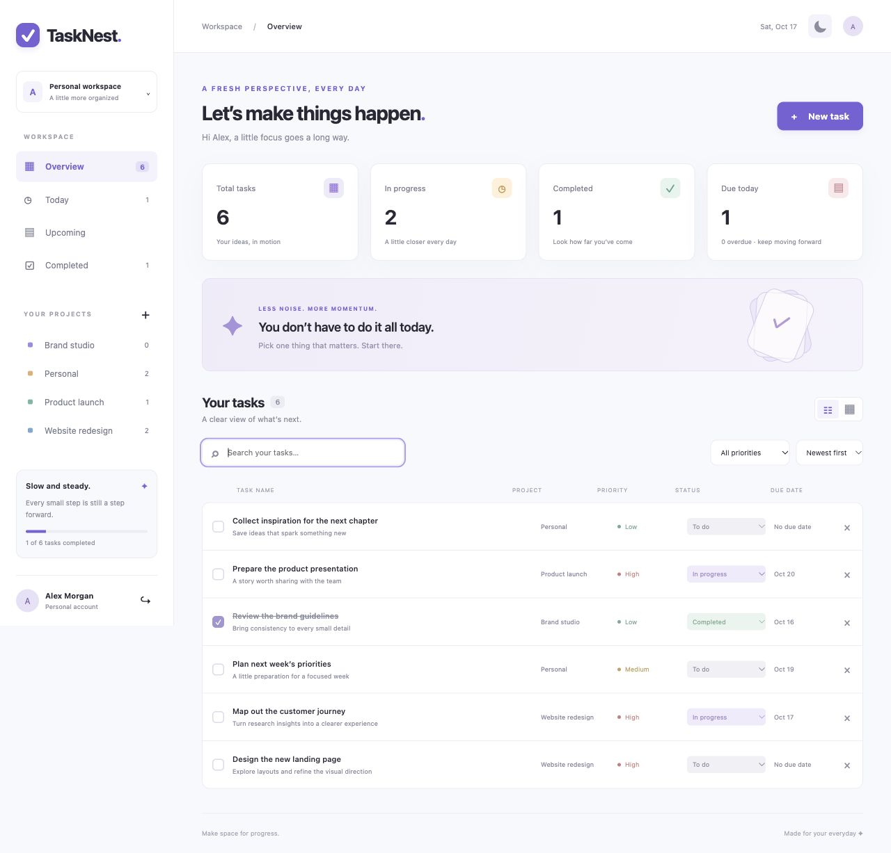
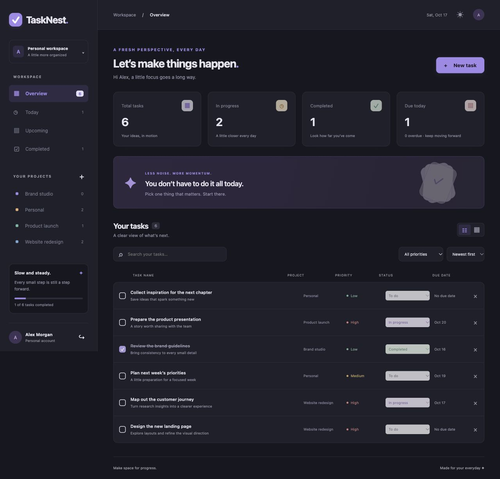
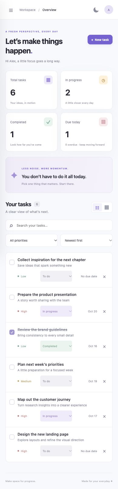
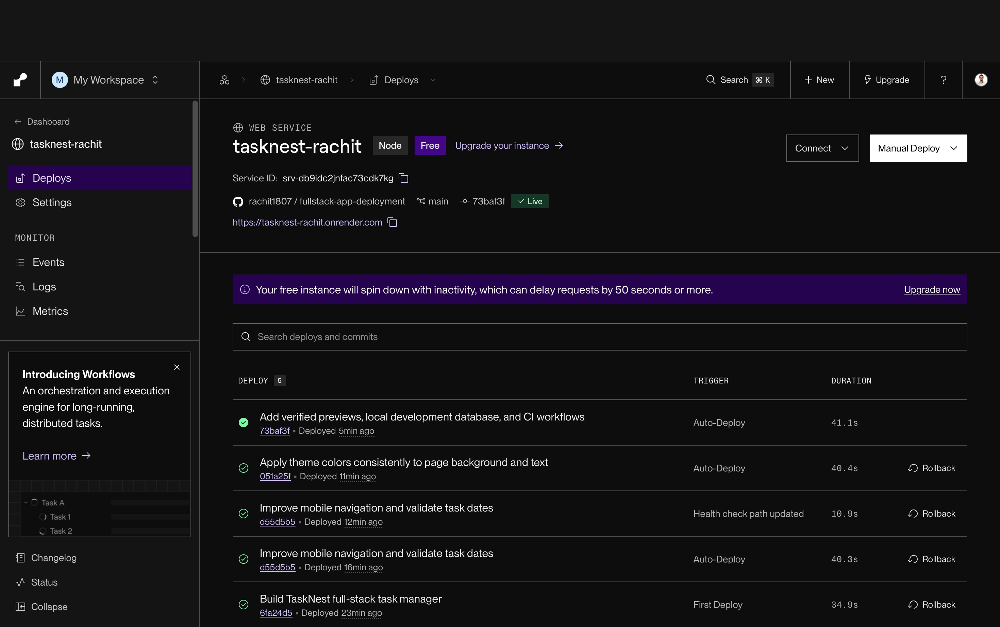

<div align="center">


# TaskNest

### Make room for what matters.

A calm, responsive workspace for tasks, projects, and everyday progress.

[Live application](https://tasknest-rachit.onrender.com) · [Deployment guide](docs/deployment-guide.md) · [API reference](docs/api.md)


</div>

## Overview

TaskNest brings personal task management into one focused workspace. Create a private account, organize tasks by project, set priorities and due dates, and switch between a clear list and a status board. Light and dark themes follow your device preference on first visit and remember your choice.

## Technology stack

<p align="center">
  
</p>

| Layer     | Technology                           | Purpose                                            |
| --------- | ------------------------------------ | -------------------------------------------------- |
| Interface | HTML5, CSS3, JavaScript              | Responsive layouts and accessible interactions     |
| Build     | Vite                                 | Optimized production assets                        |
| API       | Node.js, Express                     | Authentication and task management                 |
| Database  | PostgreSQL                           | Persistent accounts, tasks, and sessions           |
| Security  | bcryptjs, Helmet, express-rate-limit | Password hashing, response headers, sign-in limits |
| Sessions  | express-session, connect-pg-simple   | Server-side sessions with HTTP-only cookies        |
| Testing   | Playwright                           | Browser and API workflow verification              |
| Hosting   | Render                               | HTTPS, production builds, and GitHub deployments   |

## Features

- Account registration, sign-in, sign-out, and persistent sessions.
- Private task storage with account-scoped access on every task endpoint.
- Create, edit, complete, reopen, and delete tasks.
- Descriptions, project names, priorities, due dates, and three workflow statuses.
- Overview, Today, Upcoming, Completed, and project-specific views.
- Search across titles, descriptions, and projects; filter by priority; sort by date or priority.
- List and board views, summary cards, completion progress, and overdue indicators.
- Responsive navigation and layouts for phones, tablets, and desktops.
- Persistent light/dark theme, keyboard focus states, native dialogs, and form validation.
- Empty states, loading protection during submission, and readable error messages.

## Screenshots

| Desktop · light                                        | Desktop · dark                                       |
| ------------------------------------------------------ | ---------------------------------------------------- |
|  |  |

<p align="center"></p>

## Quick local preview

For a local workspace without installing a PostgreSQL server, install the dependencies, build the interface, and use a `.env` file with `LOCAL_DATABASE_PATH=.tasknest-data`, a random `SESSION_SECRET`, `NODE_ENV=development`, and `PORT=3038`. Then run `npm run dev` and open [localhost:3038](http://localhost:3038).

This preview uses PGlite, an embedded PostgreSQL-compatible development database. Its data stays in the ignored `.tasknest-data/` folder across restarts. The deployed app uses managed PostgreSQL. Never enable this preview setting in production.

## Run locally with PostgreSQL

**Requirements:** Node.js 22 or later, npm, and PostgreSQL 16 or later.

```sh
git clone https://github.com/rachit1807/fullstack-app-deployment.git
cd fullstack-app-deployment
npm ci
cp .env.example .env
```

Create a PostgreSQL database and update `DATABASE_URL` and `SESSION_SECRET` in `.env`. Use a randomly generated session secret of at least 32 bytes. Never commit this file.

```sh
npm run build
npm run dev
```

Open [localhost:3000](http://localhost:3000). The server creates its schema and tables on startup. After changing the interface, run `npm run build` and refresh the page. `npm run dev` starts the application. Use `npm run dev:watch` for optional server file watching; neither command provides frontend hot reload.

### Environment variables

| Variable          | Required   | Description                                      |
| ----------------- | ---------- | ------------------------------------------------ |
| `DATABASE_URL`    | Yes        | PostgreSQL connection string                     |
| `SESSION_SECRET`  | Yes        | Random session signing secret                    |
| `DATABASE_SCHEMA` | No         | Dedicated schema; defaults to `tasknest`         |
| `PORT`            | No         | HTTP port; defaults to `3000`                    |
| `NODE_ENV`        | Production | Set to `production` on Render for secure cookies |

## Project structure

```text
client/
  app.js                  # Browser interactions and views
  style.css               # Responsive light/dark styles
  index.html              # App entry and task dialog
  public/favicon.svg      # Brand asset
server/
  index.js                # API, database setup, and static hosting
docs/
  api.md
  deployment-guide.md
  screenshots/
tests/                    # Browser and API workflow tests
.env.example
render.yaml
package.json
```

## Deployment

The frontend and backend share one Render web service and one origin. Express serves Vite’s compiled assets and handles `/api/*`. Relative API URLs avoid cross-origin cookie and CORS configuration. Browser routes fall back to the application entry point; unknown API endpoints return JSON errors.

See the [deployment guide](docs/deployment-guide.md) for hosting settings, database configuration, verification, and troubleshooting.

The current deployment uses its own Neon PostgreSQL 16 project in Singapore, with a dedicated `tasknest` database and database role. The `tasknest` schema contains users, tasks and persistent sessions. It no longer shares the original Render database. The production branch has no scheduled expiry; free-plan usage limits still apply. Keep independent backups and monitor usage.

## Verification

Run `npm test` to execute the API and desktop/mobile browser workflows against an isolated test database. Install the browser once with `npx playwright install chromium`. GitHub Actions also builds and checks the project on pushes and pull requests. See the [verification notes](docs/verification.md) for deployment checks and recorded results.

<details>
<summary>Hosting proof</summary>



</details>

## Security and scope

Passwords are hashed with bcrypt. Task queries use parameters and include the signed-in account ID. Sessions live in PostgreSQL; production cookies use HTTPS, HTTP-only, and SameSite protections. Mutating browser requests reject foreign origins. Authentication is rate limited. User-supplied text is escaped before display.

TaskNest is a personal task manager. Email verification, password recovery, shared project membership, and file attachments are outside this version’s scope.

## License

MIT © 2026 Rachit Tripathi
