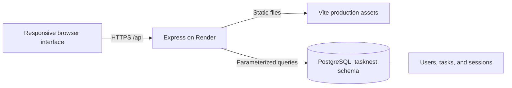

# Deploy TaskNest on Render

## Architecture

The frontend and API run on the same origin. No frontend API key is needed. CORS does not need a wildcard: the browser calls relative `/api` paths and sends its same-origin session cookie.

## 1. Prepare the source

1. Push the complete repository to GitHub.
2. Run `npm ci`, `npm run build`, and `npm test` locally.
3. Confirm `.env`, `node_modules`, and test artifacts are ignored.

## 2. Connect PostgreSQL

Use the dedicated Neon PostgreSQL 16 project in Singapore. Set `DATABASE_URL` to its **direct, unpooled TLS** connection string with `sslmode=require`. TaskNest sets a session search path, so use the direct endpoint rather than the transaction pooler. Keep this value in Render environment settings, never in the README, source, screenshots, or Git history.

This deployment has its own Neon project, `tasknest` database and role, with `DATABASE_SCHEMA=tasknest`. Users, tasks and database-backed sessions were copied together. Other projects use separate databases.

The Neon production database has **no scheduled expiry**. Free-plan compute, storage, transfer and recovery limits apply. Keep independent backups and review usage; perpetual free service is not guaranteed. Free web services can sleep when idle, so the first request may take longer.

## 3. Create the web service

| Setting       | Value                                   |
| ------------- | --------------------------------------- |
| Repository    | `rachit1807/fullstack-app-deployment`   |
| Branch        | `main`                                  |
| Runtime       | Node.js                                 |
| Region        | Singapore                               |
| Instance      | Free                                    |
| Build command | `npm ci --include=dev && npm run build` |
| Start command | `npm start`                             |
| Health check  | `/api/health`                           |
| Auto-deploy   | On, from `main`                         |

`render.yaml` provides the reproducible web-service settings. It intentionally asks for `DATABASE_URL` rather than creating another database. Supply the dedicated Neon database URL securely in Render.

## 4. Set environment variables

- `NODE_ENV=production`
- `DATABASE_SCHEMA=tasknest`
- `DATABASE_URL`: direct TLS PostgreSQL URL from Neon
- `SESSION_SECRET`: a unique random secret (at least 32 bytes)

Render provides `PORT`. The app binds to `0.0.0.0` and uses that port. Secure cookies require the public HTTPS URL; Express trusts the Render proxy.

## 5. Schema and data setup

On startup the service creates the dedicated schema, `users`, and `tasks` tables if absent. `connect-pg-simple` creates the schema’s `session` table. Setup is idempotent and does not drop existing data. The first deployment starts with an empty workspace: users create their own accounts and tasks. No local private data is uploaded or seeded automatically.

## 6. Verify the deployment

1. Check that Render reports **Live**.
2. Request `/api/health`; expect HTTP 200 and `{"status":"ok"}`.
3. Register a test account, create a task, refresh, and verify it persists.
4. Edit, complete, reopen, filter, and delete a test task.
5. Sign out and sign back in; verify the same account data returns.
6. Check that a second account cannot list or modify the first account’s tasks.
7. Test mobile navigation, list/board views, forms, and both themes.
8. Verify refreshing a browser route still serves the app.

Screenshots of the running application and hosting result belong in `docs/screenshots/`. Keep secrets hidden before capturing any hosting settings.

## Troubleshooting

| Symptom                                  | Check                                                                                                |
| ---------------------------------------- | ---------------------------------------------------------------------------------------------------- |
| Service fails at startup                 | Required environment variables and database availability                                             |
| Database hostname cannot resolve locally | Use the direct Neon hostname and verify network access and TLS |
| Login succeeds but session disappears    | HTTPS, `NODE_ENV`, proxy configuration, and cookie blocking                                          |
| Blank page after changes                 | Build assets with `npm run build`; confirm `dist/index.html` exists                                  |
| Slow initial request                     | Free service cold start                                                                              |
| Database unavailable         | Check Neon compute status, credentials, quota usage and TLS settings                                                   |

## Automated verification

`npm test` runs browser and API tests against an isolated in-memory PostgreSQL-compatible PGlite test database. It does not connect to TeamHub or production. Install the Playwright browser once with `npx playwright install chromium`. Tests cover registration, authentication, task ownership, invalid input, task persistence across sign-in, task editing/completion, filtering, theme persistence, and mobile overflow/navigation.

To run the same workflow tests against a deployed service, set `TEST_BASE_URL` to its HTTPS origin. This creates disposable test accounts and task records; run only against an environment you are authorized to test.
